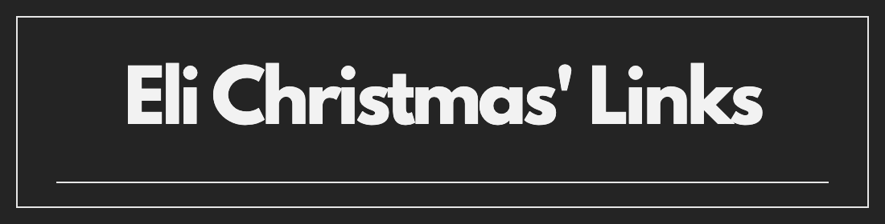
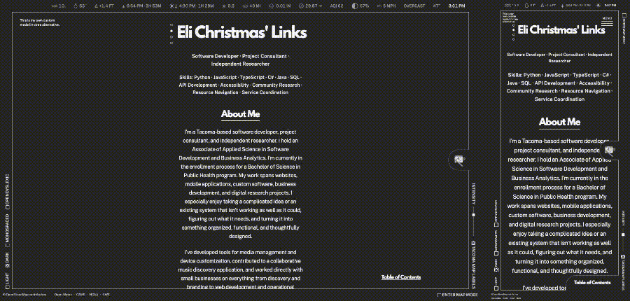
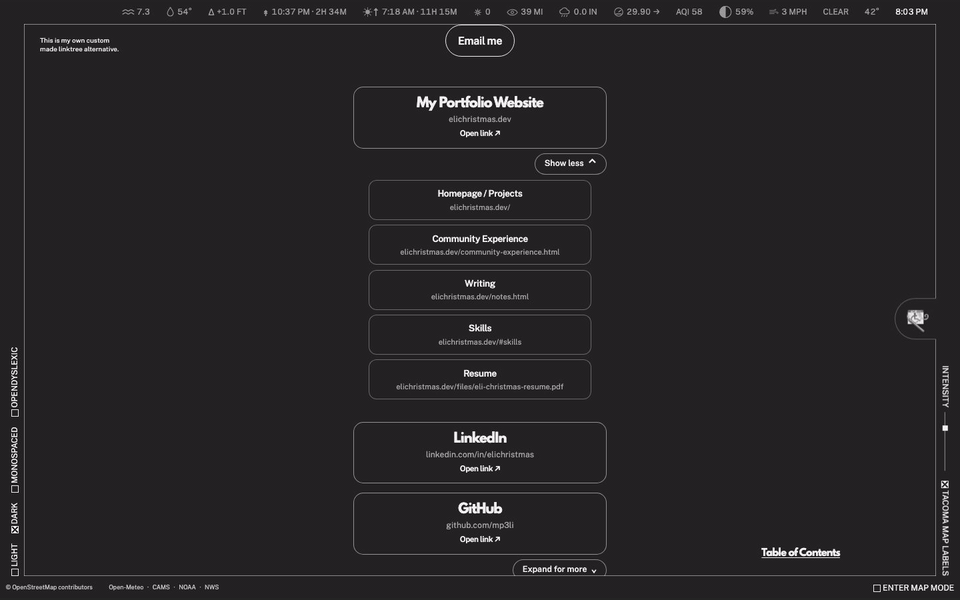
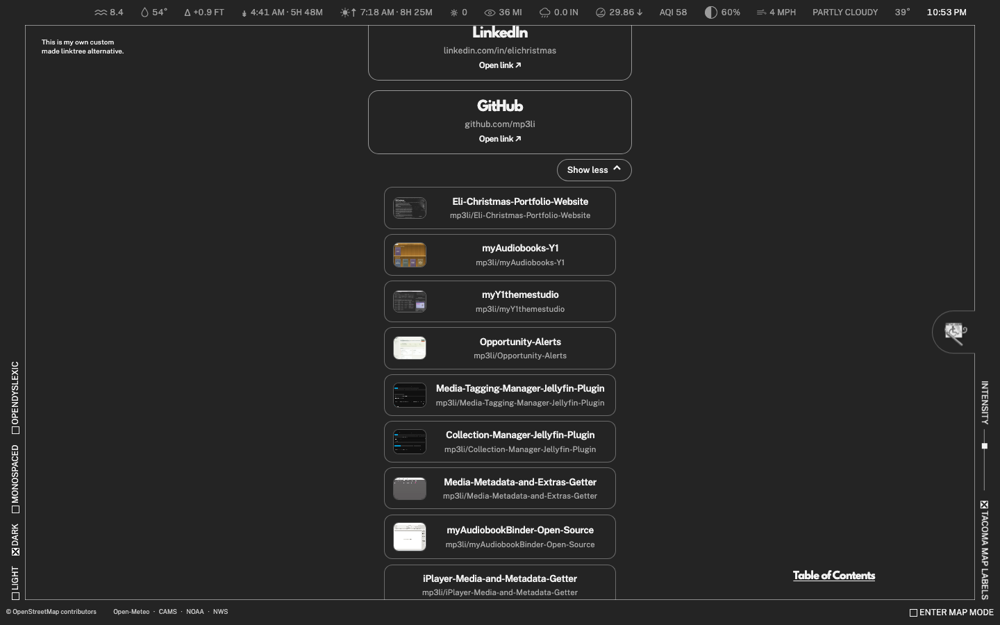
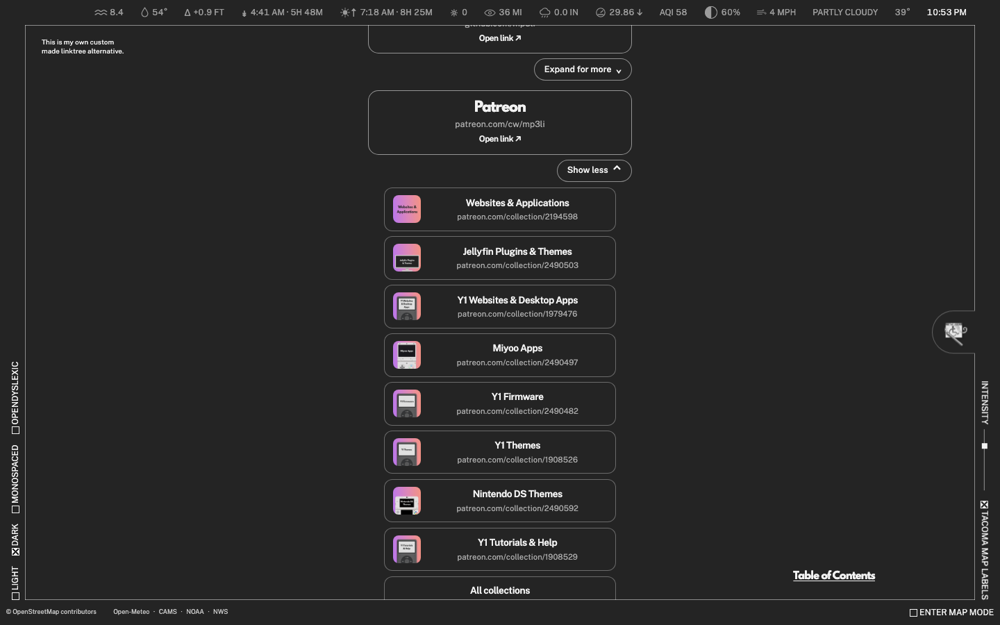
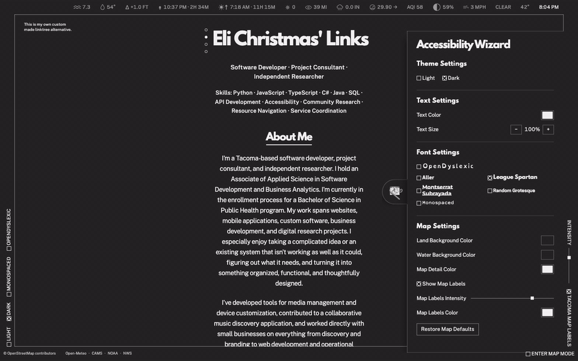
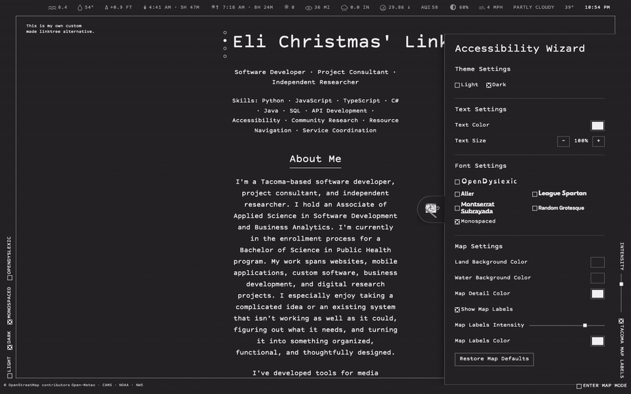
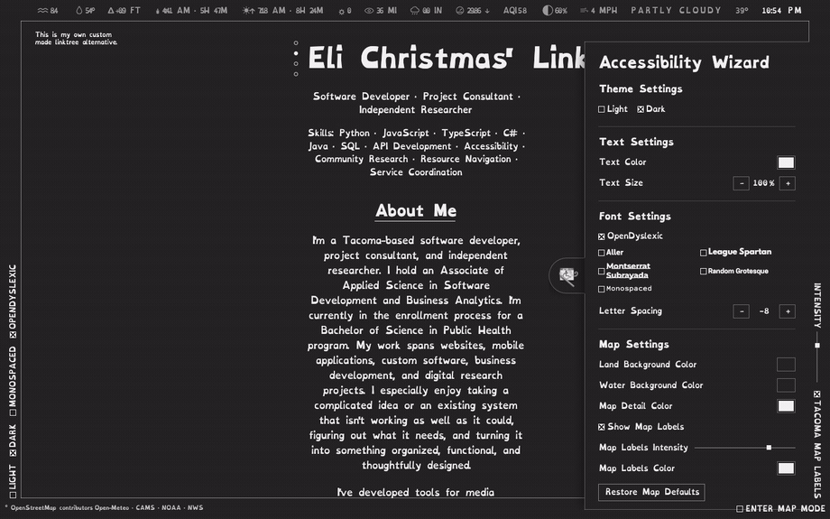
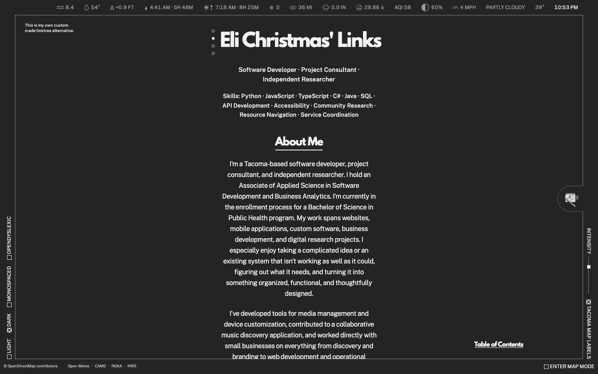
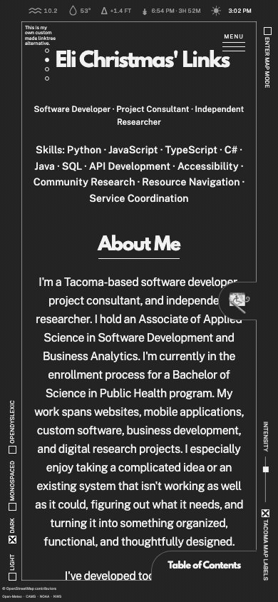

<h1 align="center">
  
</h1>

  My own linktree alternative: one place for my portfolio, projects, public code, Patreon collections, writing, and other places to find me. It uses the same Tacoma map, frame, typography, local conditions, and viewing controls as my portfolio website.

  &nbsp;
  &nbsp;
  &nbsp;
  &nbsp;
  &nbsp;
  &nbsp;
  &nbsp;
  &nbsp;
  

  
   
  Desktop and mobile scroll together in dark mode, then light mode. Select the preview to open the full-resolution video.

## Table of Contents

Open Table of Contents

 

- [My Personal Linktree Alternative](#my-personal-linktree-alternative)
- [What It Includes](#what-it-includes)
- [Explore the Links](#explore-the-links)
- [Github Repo Links Order Auto Updates Every 24 Hours](#github-repo-links-order-auto-updates-every-24-hours)
- [Tacoma Map and Local Conditions](#tacoma-map-and-local-conditions)
- [Accessibility and Appearance](#accessibility-and-appearance)
- [Desktop and Mobile](#desktop-and-mobile)
- [How It Was Built](#how-it-was-built)
- [Media, Data, and Reuse](#media-data-and-reuse)
- [Find Me Elsewhere](#find-me-elsewhere)

## My Personal Linktree Alternative

I wanted a small place that made it easy to find my work without sending everyone through a full portfolio first. The page begins with my name, roles, skills, a short introduction, and an **Email me** button. The rest is a focused set of links to the places where I share projects, code, collections, and writing. It works for people discovering my projects and for anyone who wants to contact me about professional work.

I already own **elichristmas.dev**, and I wanted the links page to be fully customizable without paying another monthly subscription for a link landing page service. Building it myself lets me use the same visual and interactive shell as [my portfolio](https://elichristmas.dev/): the Tacoma background map, surrounding frame, local status bar, table of contents, typography, and Accessibility Wizard. The content sits in a narrow, centered column on both wide and narrow screens, following the familiar style of link landing page services at a much more personalized scale.

## What It Includes

- **A short introduction:** the About Me text opens with its first paragraphs and can expand for more.
- **Direct contact:** the Email me button opens an email draft.
- **Clear link actions:** a main button opens its destination; a separate **Expand for more** button reveals related links below it.
- **Grouped sublinks:** expanded buttons are narrower than their parent, with extra space before the next main link.
- **Public project media:** matching GitHub projects retain the images, GIFs, or video previews used on my portfolio. Repositories without suitable preview media remain text-only.
- **Patreon collection covers:** each collection has its own destination and cover image.
- **Quick navigation:** a table of contents and compact mobile menu help visitors reach a section.
- **The portfolio viewing controls:** light and dark modes, font and text options, map controls, and keyboard access.

## Explore the Links

The main destinations are **My Portfolio Website**, **LinkedIn**, **GitHub**, **Patreon**, **Substack**, and **Reddit**. The portfolio expands to Homepage / Projects, Community Experience, Writing, Skills, and my résumé. GitHub expands to my public repositories, including [Hidden Gem Music](https://github.com/Hidden-Gem-Music/Hidden-Gem-Music). Patreon expands to eight individual collections, beginning with Websites & Applications and related software work.

The smaller cards keep their parent link visible above them. Opening an expanded list does not turn the next unrelated destination into another item in that list.

  
   
  The portfolio's related links are inset below their main destination.

  
   
  Public repositories use their existing project previews where available.

  
   
  Each Patreon collection has its own cover and link.

## Github Repo Links Order Auto Updates Every 24 Hours

Expand the **GitHub** section to see links to my public repositories underneath the main button for [my GitHub profile](https://github.com/mp3li). Every 24 hours, a scheduled Cloudflare Worker checks the most recent commit on each repository's default branch, then updates the order of those links so the most recently committed projects appear first. The list includes my public `mp3li` repositories and [Hidden Gem Music](https://github.com/Hidden-Gem-Music/Hidden-Gem-Music).

The Worker stores the latest successful order for the page to read. The page has a built-in list if that stored order is temporarily unavailable. Reordering preserves existing project images, GIFs, and video previews; a newly public repository can appear as a text-only link until I add media for it.

## Tacoma Map and Local Conditions

The map and status bar are the same ones used by my portfolio. The map is drawn from bundled Tacoma map geometry and place labels based on OpenStreetMap data. The page builds land, water, road, and label layers on canvases, then uses WebGL for the moving line and water effects. The map does not need a live tile service to draw its streets and shoreline. It sits behind the content and extends across the frame while the links remain in their centered column.

Visitors can drag the map, use its directional buttons, or press **Home** or **Recenter map** to return to the starting view. The map region also supports the keyboard arrow keys. A dedicated map mode gives the geography more room, while the Accessibility Wizard can adjust the map colors, label visibility, and label intensity. Reduced-motion settings affect the animation.

The status bar shows these Tacoma and Commencement Bay details:

| Display | Source and meaning |
| --- | --- |
| Tacoma time | A local clock using the America/Los_Angeles time zone. |
| Tide height | NOAA's observed Commencement Bay water level, with a rising or falling direction. |
| Water temperature | NOAA's most recent Commencement Bay water temperature. |
| Tide difference | Observed water level minus NOAA's prediction at the same time. |
| Next tide | NOAA's next predicted high or low tide, with its time and countdown. |
| Sunrise or sunset | The next event and countdown from Open-Meteo's Tacoma forecast. |
| UV index | Open-Meteo's hourly UV value for the current hour. |
| Visibility | Open-Meteo's current visibility, converted to miles. |
| Rain | Open-Meteo's hourly precipitation added up since local midnight, in inches. |
| Barometric pressure | NOAA's recent station reading, converted to inches of mercury with a trend direction. |
| Air quality | The current US AQI from Open-Meteo's air-quality API, credited to Copernicus CAMS. |
| Moon | The current moon phase and estimated illumination, calculated in the browser. |
| Wind | Open-Meteo's current wind speed in miles per hour. |
| Conditions and temperature | Open-Meteo's current weather code description and air temperature in Fahrenheit. |
| Weather alert, when present | The National Weather Service's active Tacoma alerts; a wind or gale alert appears when one matches. |

The weather forecast and air quality come from separate [Open-Meteo APIs](https://open-meteo.com/). Water level, tide predictions, water temperature, and pressure come from [NOAA Tides & Currents station 9446484](https://tidesandcurrents.noaa.gov/stationhome.html?id=9446484). Alerts come from the [National Weather Service API](https://www.weather.gov/documentation/services-web-api). The page refreshes weather and alerts every 15 minutes, NOAA readings every six minutes, and its clocks and countdowns more often. If a service is unavailable, its affected value shows an unavailable state rather than an invented reading.

## Accessibility and Appearance

The **Accessibility Wizard** offers light and dark themes, text and font settings, OpenDyslexic, and map display controls. The page also keeps the portfolio's keyboard skip link, labeled controls, keyboard map movement, and reduced-motion behavior. Visitors can change how the page looks without changing the destinations.

  
   
  The same page in dark and light appearances, with the viewing controls open.

  
   
  Monospaced type in dark and light modes.

  
   
  OpenDyslexic type in dark and light modes.

## Desktop and Mobile

On desktop, the links sit in a centered narrow column inside the full portfolio frame. On mobile, the same buttons stack within the frame, with a compact menu and a four-line note tucked into its upper-left corner. The primary destinations and expanded lists remain separate buttons at either width.

  
   
  The wide layout keeps the portfolio frame around a compact links-page column.

  
   
  The mobile page from the introduction through the link list in both themes.

## How It Was Built

The page uses HTML, CSS, and browser JavaScript. Its frame, map, Tacoma information, typography, appearance options, and Accessibility Wizard come from my existing portfolio website; the personal link groups and expand/collapse behavior are specific to this page. Repository ordering uses a Cloudflare Worker, a scheduled job, and a small stored snapshot. Visitors do not need an account to use the page.

## Media, Data, and Reuse

The README images, GIFs, and video were captured from the running links page. They show the real page and controls. Live Tacoma values, public repositories, and collection content may change after these captures.

The map credits [OpenStreetMap contributors](https://www.openstreetmap.org/copyright). The status bar links to [Open-Meteo](https://open-meteo.com/), [Copernicus Atmosphere Monitoring Service](https://ads.atmosphere.copernicus.eu/), [NOAA Tides & Currents](https://tidesandcurrents.noaa.gov/stationhome.html?id=9446484), and the [National Weather Service](https://www.weather.gov/documentation/services-web-alerts). Project previews and Patreon cover images come from their associated public projects and collections.

## Find Me Elsewhere

- [Portfolio website](https://elichristmas.dev/)
- [LinkedIn](https://www.linkedin.com/in/elichristmas/)
- [GitHub](https://github.com/mp3li)
- [Patreon](https://www.patreon.com/cw/mp3li)
- [Substack](https://elichristmas.substack.com/)
- [Reddit](https://www.reddit.com/user/jasperhooloop/submitted/)
